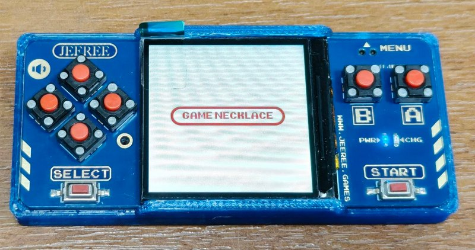
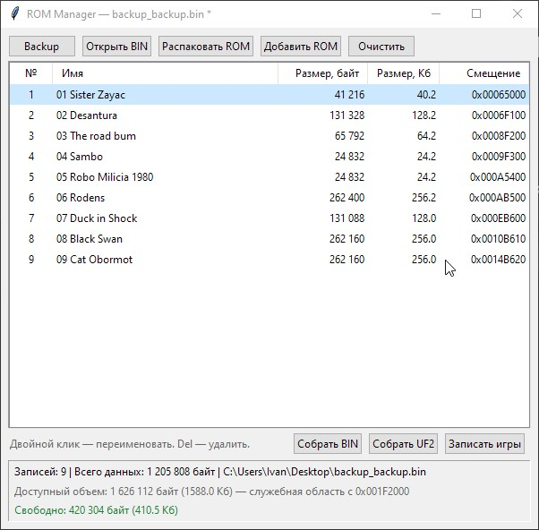

# Jeeree ROM Manager

Оконный редактор таблицы NES-игр во flash-образе приставки Jeeree.
Программа ТОЛЬКО для приставки Jeeree.



Программа позволяет открыть BIN-образ приставки, посмотреть и изменить список
игр, добавить или удалить ROM, собрать новый BIN/UF2 и записать только игры
в приставку через режим BOOTSEL, не затрагивая код эмулятора и настройки.

## Возможности

- Просмотр таблицы игр: номер, имя, размер в байтах, размер в Кб, смещение.
- Добавление одного или нескольких NES-файлов.
- Проверка ROM при добавлении:
  - поддерживаются iNES 1.0 и NES 2.0;
  - NES 2.0 автоматически преобразуется в iNES 1.0;
  - файлы с mapper больше 255 отклоняются;
  - формат UNIF и файлы без заголовка iNES не принимаются.
- Автоматическая нумерация записей: `01`, `02`, `03` и т. д.
- Переименование, удаление и полная очистка таблицы.
- Распаковка NES-файлов из таблицы в папку `ROM`.
- Открытие и сохранение BIN-образа.
- Сборка полного UF2 для приставки.
- Запись только таблицы игр и области ROM через BOOTSEL.
- Чтение полного backup с приставки через `picotool`.
- Отображение доступного объёма и свободного места.
- Защита от записи данных поверх служебной области.

## Запуск

Требования:

- Windows (основная платформа);
- Python 3.10 или новее;
- стандартная библиотека Python, включая `tkinter`;
- `picotool` — только для чтения Backup с приставки.

Запуск:

```powershell
python rom_manager.py
```

`picotool.exe` ищется в `PATH`, в папке `picotool` рядом с программой,
в текущей папке и в типовых каталогах Pico SDK. При необходимости путь можно
указать вручную в диалоге программы.

## Интерфейс



Двойной клик по имени или клавиша `F2` запускает переименование.
`Enter` подтверждает изменение, `Esc` отменяет.

Имя должно содержать только символы Latin-1 и иметь длину не более 20 байт.
После rename/delete/add номера записей пересчитываются автоматически.

Если данные не помещаются перед служебной областью, свободное место
отображается красным, а сборка/запись может потребовать подтверждения
или быть отменена.

## Горячие клавиши

| Клавиша | Действие |
|---|---|
| `Ctrl+O` | Открыть BIN |
| `Ctrl+S` | Собрать BIN |
| `Insert` | Добавить ROM |
| `F2` | Переименовать выбранную запись |
| `Delete` | Удалить выбранную запись |

Дополнительно доступно контекстное меню по правой кнопке мыши:
переименовать, удалить, считать Backup.

## Добавление ROM

При добавлении проверяется заголовок iNES/NES 2.0 и размер файла.

Для NES 2.0:

- вычисляется mapper из 12 бит;
- размеры PRG/CHR переводятся в единицы iNES 1.0;
- заголовок приводится к iNES 1.0;
- сохраняются mapper, размеры, зеркалирование и флаги;
- байты NES 2.0 в заголовке очищаются.

Если файл не подходит, он не добавляется, а причина показывается в диалоге.
Остальные корректные файлы из выбранного набора добавляются.

Максимальное количество записей — **128**.

## Открытие и сохранение BIN

При открытии файла читается таблица с адреса `0x64000` и данные игр.
Если в текущей таблице есть несохранённые изменения, программа предложит
их сохранить.

При сборке BIN:

- таблица и данные записываются в новый файл;
- байты вне таблицы и области данных сохраняются из исходного образа;
- при перекрытии служебной области запрашивается подтверждение;
- после сохранения файл становится текущим, отметка изменений снимается.

Если BIN ещё не открыт, используется путь по умолчанию:
`%USERPROFILE%\Desktop\file.bin`.

## Сборка UF2

**Собрать UF2** собирает полный образ и сохраняет его в UF2-файл для приставки:

- база адресов — `0x10000000`;
- размер блока — 256 байт данных;
- файл содержит весь образ (обычно 2 МиБ, то есть 8192 блока).

Такой UF2 можно прошить обычным способом через BOOTSEL.

## Запись игр через BOOTSEL

Кнопка **Записать игры** выполняет частичную запись:

1. Показывает инструкцию по переводу приставки в BOOTSEL.
2. Собирает UF2 только из таблицы игр и области ROM.
3. Начало области — `0x10064000` (таблица), конец выравнивается
   по секторам flash по 4096 байт.
4. Создаёт временный `temp.uf2`.
5. Ждёт появления диска BOOTSEL (диск определяется по файлу `INFO_UF2.TXT`).
6. Копирует `temp.uf2` на диск.
7. Ждёт исчезновения диска, то есть завершения прошивки и перезагрузки.
8. Удаляет временный файл.

Во время ожидания и копирования показывается прогресс. Кнопка **Отмена**
прерывает операцию. Если копирование уже началось, не отключайте приставку
до исчезновения диска.

Записываются только таблица и область ROM. Код эмулятора и служебные
настройки в UF2 не включаются. Если игры не помещаются перед служебной
областью, запись отменяется.

### Перевод приставки в BOOTSEL

1. Выключите приставку долгим нажатием `Start`.
2. Подключите приставку к компьютеру по USB.
3. Нажмите и удерживайте `Menu`.
4. Удерживая `Menu`, нажмите `Start`.
5. Отпустите `Menu`, но продолжайте удерживать `Start`.

После этого должен появиться диск BOOTSEL.

## Чтение Backup

Кнопка **Backup** читает полный flash приставки через `picotool`:

- диапазон: `0x10000000`–`0x10200000`;
- размер: 2 МиБ;
- формат: BIN.

После чтения файл сохраняется, таблица игр загружается автоматически.
Для работы нужен `picotool` и приставка в режиме BOOTSEL. Прогресс чтения
можно отменить.

## Формат BIN

Все смещения ниже — смещения внутри BIN-файла. При записи во flash
к ним добавляется базовый адрес `0x10000000`.

| Область | Смещение | Описание |
|---|---|---|
| Таблица | `0x64000` | До 128 записей по 32 байта |
| Данные игр | `0x65000` | ROM-файлы подряд |

Структура записи таблицы (32 байта):

| Смещение в записи | Размер | Поле |
|---|---|---|
| `0x00` | 20 байт | Имя, дополнено `0xFF` |
| `0x14` | 4 байта | Сигнатура `00 00 FE CA` |
| `0x18` | 4 байта | Смещение данных, little-endian |
| `0x1C` | 4 байта | Размер данных, little-endian |

Служебная область определяется как первый байт после области данных,
не равный `0xFF`.

## Ограничения

- Поддерживаются только NES-файлы в формате iNES 1.0 или NES 2.0.
- Mapper больше 255 не поддерживается.
- Имена записей ограничены Latin-1 и 20 байтами.
- Запись игр рассчитана на образ с таблицей по смещению `0x64000`
  и служебными данными после области ROM.
- Во время записи через BOOTSEL нельзя отключать приставку до исчезновения
  диска.


